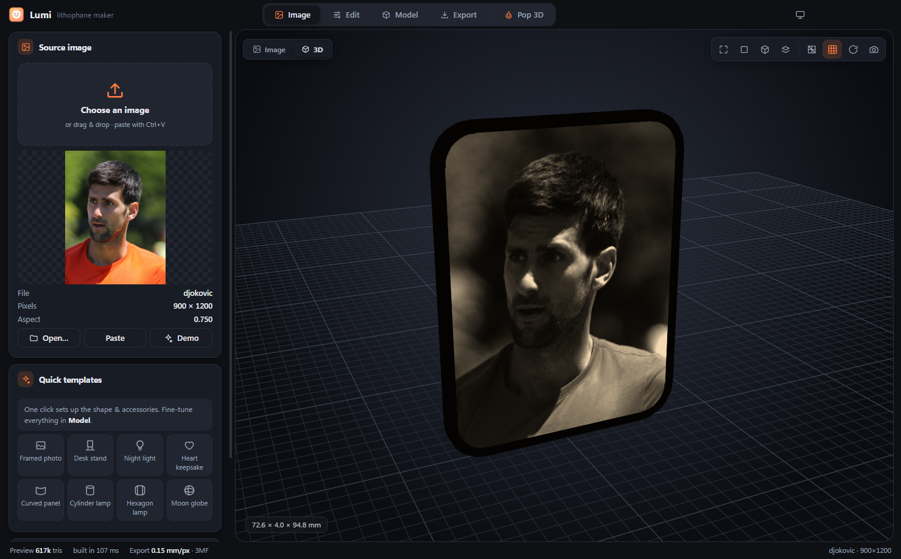
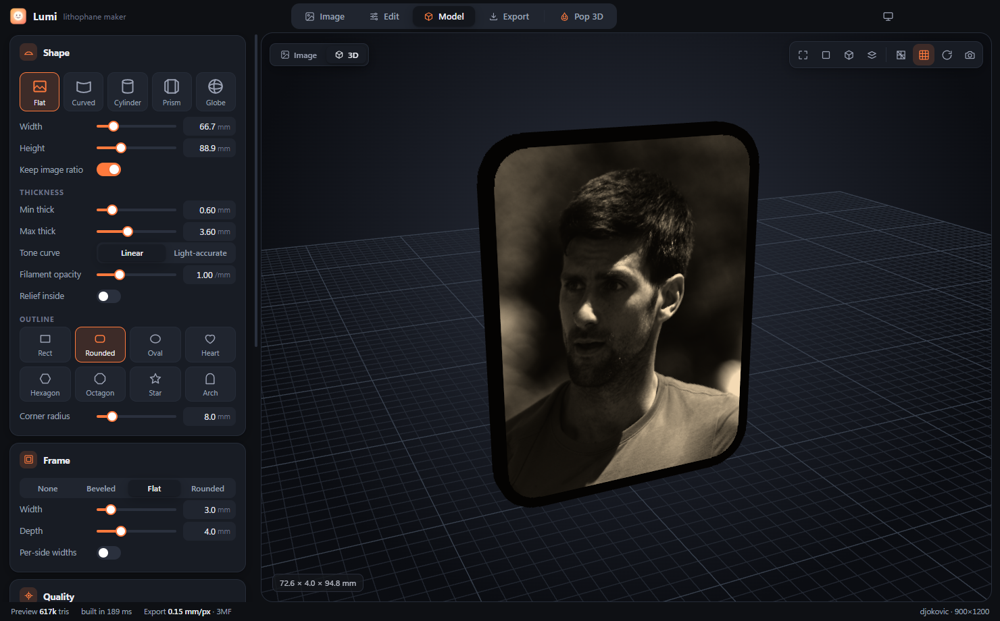
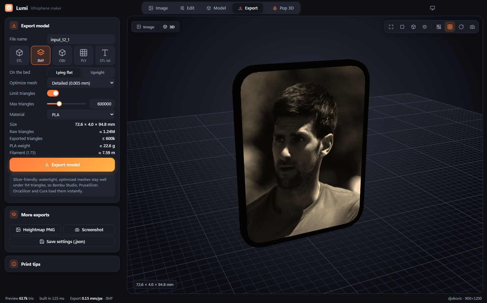
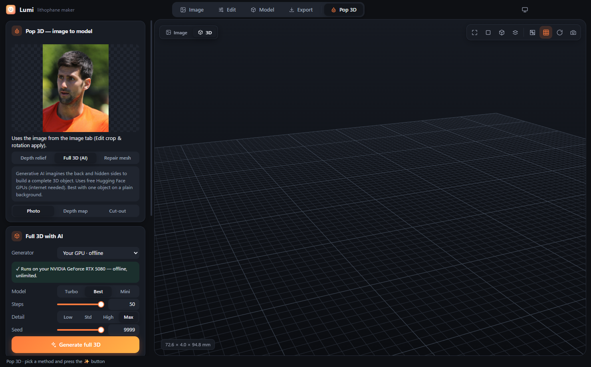

# Lumi - Lithophane and 3D Model Maker

Lumi is a Windows desktop app (Electron + Three.js) that turns your photos into **3D-printable lithophanes** and **3D models**. It also keeps every export **slicer-friendly**: meshes are watertight and optimized to stay well under 1 million triangles, so Bambu Studio, PrusaSlicer, OrcaSlicer, Creality Print and Cura load them instantly.

**🌐 Website and in-browser lithophane maker: <https://chahatdeep.github.io/Lumi/>.** It runs entirely client-side, so your photos are never uploaded.



## Features

**Lithophanes**
- **Shapes:** flat, curved, cylinder, prism (n-sided lamp) and globe (sphere with top and bottom openings).
- **Outlines:** rectangle, rounded, oval, heart, hexagon, octagon, star and arch.
- **Frames:** none, beveled, flat or rounded, with optional per-side widths.
- **Accessories:** stand/base, hanging loop, nightlight holder, lamp fitting and connectors.
- **Quick templates:** framed photo, desk stand, night light, heart keepsake, curved panel, cylinder lamp, hexagon lamp and moon globe.
- **Image editing:** crop and rotate, auto levels, brightness, contrast, gamma, shadows and highlights, smoothing, sharpening, edge fade, invert, and text overlays.
- **Thickness control:** min and max thickness, linear or light-accurate tone curve, filament opacity, and a relief-inside option.
- **Live 3D preview:** wireframe, grid, auto-rotate, preset views and screenshots, in light or dark theme.

**Pop 3D (image → 3D model)**
- **Depth relief:** a local AI depth estimate (Depth Anything V2 via transformers.js) plus AI background removal (RMBG-1.4) produces a printable relief with a flat base.
- **Full 3D (AI):** generates a complete object from one photo:
  - **On your own NVIDIA GPU, offline:** Hunyuan3D-2 (Turbo, Best or Mini models), installed by the app on first use.
  - **Online through free Hugging Face Spaces:** Hunyuan3D-2, Hunyuan3D-2.1 and TRELLIS.
- **Repair mesh:** loads an STL, OBJ or GLB, then repairs it, flattens the bottom and optimizes it.

**Export**
- **Formats:** STL (binary or ASCII), 3MF, OBJ and PLY, plus heightmap PNG, screenshots, and save/load of your settings as `.json`.
- **Mesh optimizer:** a QEM simplifier with a configurable tolerance (0.005 to 0.05 mm) and a triangle cap (default 600k).
- **Print orientation:** flat lithophanes export lying flat or upright on the bed.
- **Materials:** PLA, PETG, ABS, ASA and TPU, used for weight estimates.

| Model | Export | Pop 3D |
|---|---|---|
|  |  |  |

## Requirements

- Windows 10 or 11 (64-bit). The packaging targets Windows. The app itself is plain Electron and may run elsewhere in dev mode, but only Windows is tested.
- [Node.js](https://nodejs.org/) 20 or newer (developed on Node 25) and npm.
- Git.
- Optional, for **offline full-3D generation**:
  - an NVIDIA GPU with about 8 GB or more of VRAM and a recent driver (`nvidia-smi` must work);
  - about 15 GB of free disk space for the Python runtime and model weights.
- Optional, for the **online generators**: an internet connection. A free Hugging Face "read" token gives you much more GPU time.

## Install

```bash
git clone https://github.com/chahatdeep/Lumi.git
cd Lumi
npm install
```

## Run in development

```bash
npm start
```

`npm start` first runs `build/vendor.js`, which copies the runtime libraries (three.js, OrbitControls, fflate, earcut, transformers.js and the onnxruntime-web WASM) from `node_modules` into `src/vendor/`, then launches Electron. To open DevTools as well:

```bash
npx electron . --dev
```

## Build the Windows app

```bash
npm run dist
```

This writes to `dist/`:

- `Lumi Setup 1.0.0.exe`, an NSIS installer that lets you choose the install folder;
- `Lumi-1.0.0-portable.exe`, a single portable executable;
- `win-unpacked/`, the unpacked app.

To regenerate the app icon (`build/icon.png`), run `npm run icon`.

## Website (GitHub Pages)

The website at <https://chahatdeep.github.io/Lumi/> contains a landing page (`site/`) and a browser build of the lithophane maker. The maker is Lumi's own renderer (`src/`), with the desktop-only Pop 3D tab hidden. That means the web and desktop apps produce the same meshes.

```bash
npm run site                                # assembles _site/
python -m http.server 8080 --directory _site   # then open http://localhost:8080
```

Every push to `main` builds and deploys it through `.github/workflows/pages.yml`.

The real-light renders on the site come from `build/render/`:
- `make-stl.js` builds a lithophane with Lumi's engine.
- `make-3d.js` runs Pop 3D's local Hunyuan3D-2 pipeline.
- `render.py` and `render-bust.py` are the Blender Cycles scenes.

`npm run card` regenerates the link-preview image.

## How to use

### Make a lithophane

1. **Image tab:** open, drag and drop, or paste (Ctrl+V) a photo, or start from a **Quick template**.
2. **Edit tab:** crop and rotate, then adjust levels, contrast, smoothing and edge fade, and add text if you like. Hold the compare button to see the original.
3. **Model tab:** choose the shape, size, thickness range and outline, then add a frame, stand, hanger, nightlight holder or lamp fitting.
4. **Export tab:**
   1. Pick a format (STL or 3MF are recommended) and **On the bed** (lying flat or upright).
   2. Keep **Optimize mesh** on *Balanced* and **Limit triangles** on.
   3. Click **Export model**. The status line shows the final triangle count and file size.

**Print tips (also in the app):**
- Use 100% infill.
- Use a layer height of 0.08 to 0.12 mm.
- Use white PLA, and match **Filament opacity** to it.
- Add a 5 mm brim for tall upright prints.
- Print outer walls slowly, at about 40 mm/s.

### Make a 3D model (Pop 3D)

1. Load an image in the **Image** tab. The crop and rotation from the Edit tab carry over.
2. Open **Pop 3D** and choose a method:
   - **Depth relief:** pick the depth AI and background handling, then size, depth, base and edge rounding.
   - **Full 3D (AI):** pick a generator.
     - **Your GPU · offline:** the first run installs an isolated Python runtime and downloads the model, which takes a few GB.
     - **Online generators:** these run on Hugging Face. Hunyuan3D-2.1 and TRELLIS need a free HF token, which you paste in the panel. It is stored only on your PC.
   - **Repair mesh:** load an existing STL, OBJ or GLB.
3. Export as STL, 3MF, OBJ or PLY. The same optimizer and triangle cap apply.

## Project layout

```
main.js            Electron main process (window, file dialogs, IPC)
preload.js         Safe bridge exposed to the renderer as window.lumi
hf.js              Hugging Face Spaces client (gradio) for the online generators
local3d.js         Installs and runs the local GPU Hunyuan3D-2 worker
python/            lumi_local3d.py, the local GPU worker (JSON over stdin/stdout)
src/               Renderer: UI (app.js, ui.js), mesh generation (mesh.js, layout.js),
                   simplifier (simplify.js), exporters, image processing, Pop 3D, viewer
build/             vendor.js (copies runtime libs), make-icon.js, icon.png, site.js (website build)
site/              Website landing page and the browser-only style overrides
```

## Troubleshooting and build gotchas

- **Blank 3D view, or errors about `three` or `OrbitControls` not found.** `src/vendor/` is missing. Run `npm run vendor`; `npm start` and `npm run dist` also do this. The libraries are vendored because electron-builder strips `node_modules/*/examples`, which is where OrbitControls lives.
- **`npm run dist` fails with a `winCodeSign` symlink error ("A required privilege is not held by the client").** electron-builder's winCodeSign archive contains macOS symlinks, and Windows can't create them without Developer Mode. Either:
  - turn on **Settings → System → For developers → Developer Mode**, or
  - pre-extract the archive (skipping the `*.dylib` files) into `%LOCALAPPDATA%\electron-builder\Cache\winCodeSign\winCodeSign-2.6.0\`, then build again.
- **"GPU quota exceeded" or a generator fails right away.** The online Spaces use Hugging Face ZeroGPU, and the anonymous allowance is only a few runs. Add a free HF read token from <https://huggingface.co/settings/tokens>, wait for the quota to reset, or use the offline GPU generator.
- **`ECONNRESET` errors talking to huggingface.co.** Lumi already routes these requests through Chromium's network stack (`electron.net.fetch`), which retries and honours system proxies. If it keeps happening, check your firewall or proxy and try again.
- **The local GPU generator does not appear.** The app looks for an NVIDIA GPU with `nvidia-smi`. Install or update the NVIDIA driver.
- **Local model install or download stops partway.**
  - Retrying resumes the download.
  - Everything lives in `%LOCALAPPDATA%\Lumi-AI`. You can remove it from inside the app (uninstall), or delete that folder to start fresh.
  - The runtime pins `transformers<5` and `diffusers<0.36`, because newer versions break Hunyuan3D-2.
- **The slicer is slow or warns about too many triangles.** Keep **Limit triangles** on, or choose **Optimize mesh → Small file**.
- **A flat lithophane shows up standing in the slicer.** Set **Export → On the bed → Lying flat**.

## License

Lumi is **source-available for non-commercial use** under the [PolyForm Noncommercial License 1.0.0](LICENSE). You are free to use, modify and share it for personal, hobby, educational, research and other non-commercial purposes.

**Commercial use needs a separate license.** This includes selling Lumi, selling prints made as part of a business, or using it inside a company. For commercial licensing, contact **Chahat Deep Singh** via [GitHub](https://github.com/chahatdeep).

Copyright © 2026 Chahat Deep Singh. See [NOTICE](NOTICE).

**Demo photo:** the website, screenshots and renders use ["Novak Djokovic"](https://commons.wikimedia.org/wiki/File:Novak_Djokovic_(34775891004)_(cropped).jpg) by Andrew Campbell, licensed [CC BY 2.0](https://creativecommons.org/licenses/by/2.0/). It was cropped, turned into a lithophane and a 3D model, and rendered. Lumi is not affiliated with or endorsed by Novak Djokovic.

Third-party libraries (three.js, fflate, earcut, transformers.js, onnxruntime-web, @gradio/client and Electron) and AI models (Depth Anything V2, RMBG-1.4, Hunyuan3D-2/2.1, TRELLIS and Marigold) keep their own licenses. Some models, such as RMBG-1.4 and Hunyuan3D, have their own non-commercial or regional terms. Check them before using outputs commercially.
